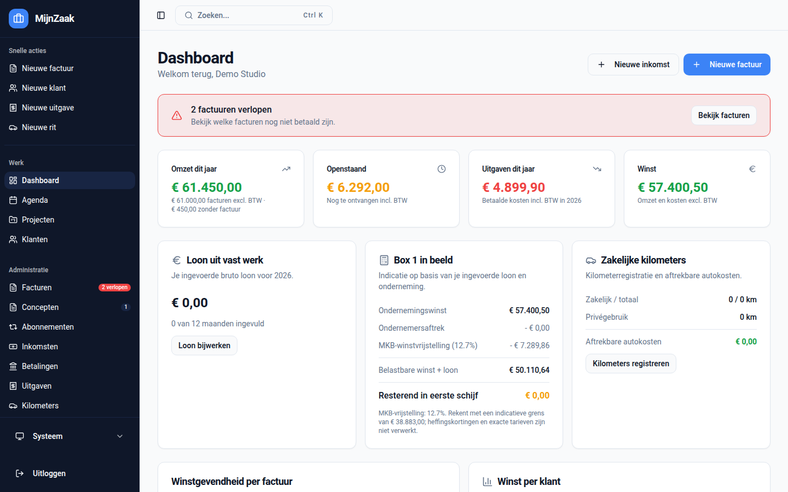
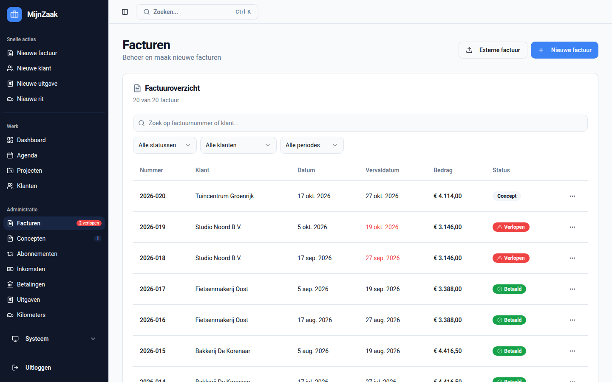
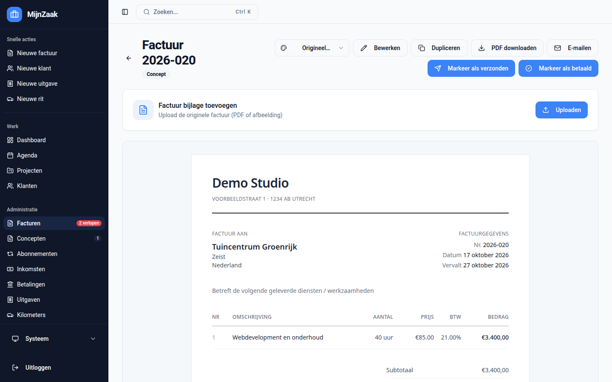
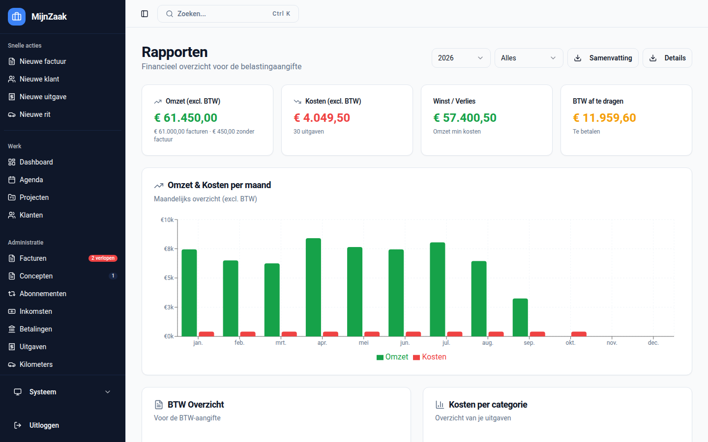
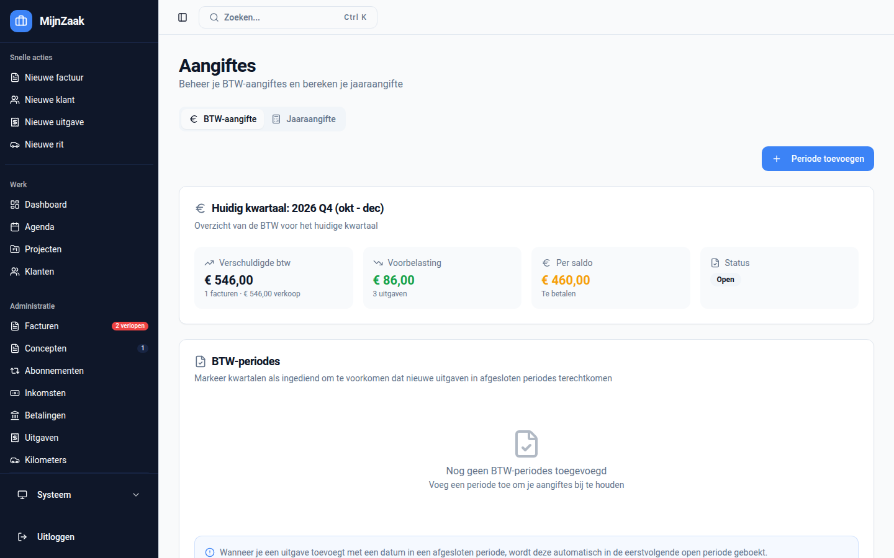
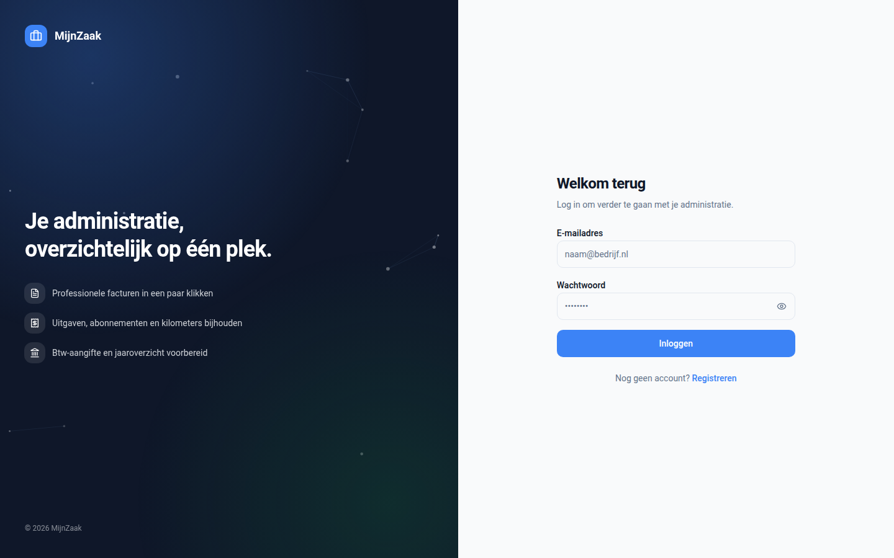
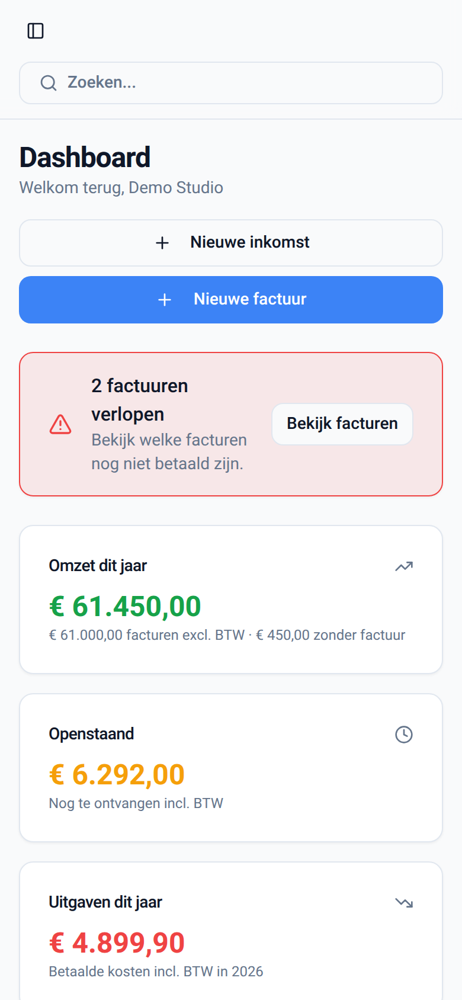
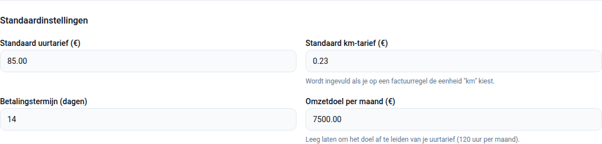

# Easy Invoice Hub

Easy Invoice Hub is een self-hosted facturatie- en administratie-app voor freelancers en kleine ondernemers. De app helpt met facturen, klanten, projecten, uren, uitgaven, kilometers, BTW-aangiftevoorbereiding en rapportages, zonder afhankelijkheid van een externe SaaS-dienst.

De applicatie bestaat uit een React/Vite frontend, een Node.js/Express API en een PostgreSQL database. Kant-en-klare Docker images staan op GitHub Container Registry, dus je kunt hem binnen een paar minuten draaien.



## Inhoud

- [Features](#features)
- [Screenshots](#screenshots)
- [Snel starten met Docker](#snel-starten-met-docker)
- [Eerste gebruik](#eerste-gebruik)
- [Updaten](#updaten)
- [Zelf images bouwen](#zelf-images-bouwen)
- [Lokale ontwikkeling](#lokale-ontwikkeling)
- [Omgevingsvariabelen](#omgevingsvariabelen)
- [PWA en pushmeldingen](#pwa-en-pushmeldingen)
- [Database migraties](#database-migraties)
- [Backup en restore](#backup-en-restore)
- [Productie](#productie)
- [Problemen oplossen](#problemen-oplossen)
- [Beveiliging](#beveiliging)
- [Bijdragen](#bijdragen)

## Features

- **Facturen**: maken, bewerken, dupliceren, als PDF downloaden en per e-mail versturen, met meerdere templates.
- **Factuurstatussen**: concept, verzonden, betaald, verlopen en geannuleerd, inclusief betaaldatum.
- **Externe facturen** en bijlagen registreren.
- **Klantenbeheer** met bedrijfs- en contactgegevens.
- **Projecten en urenregistratie**, met uurtarief per project of een standaardtarief.
- **Uitgaven** inclusief BTW, reverse charge en bonuploads.
- **Kilometerregistratie** met standaard km-tarief en eenheid "km" op factuurregels.
- **Overige inkomsten, abonnementen en loon uit vast werk** voor een compleet beeld.
- **BTW**: periodes beheren, kwartalen afsluiten en aangiftevelden per kwartaal voorbereiden.
- **Dashboard en rapportages**: omzet, kosten, winst, BTW, Box 1-indicatie, omzetdoel en gezondheidsindicatoren.
- **PWA** voor installatie op telefoon of desktop, met pushmeldingen voor verlopen facturen.
- **Authenticatie**: lokale login met JWT refresh tokens, optionele 2FA en optionele Authentik OAuth.
- **Admin-instellingen** voor registratie, SMTP en systeemconfiguratie.

## Screenshots

| Facturen | Factuurdetail |
| --- | --- |
|  |  |

| Rapportages | BTW-aangifte |
| --- | --- |
|  |  |

| Inloggen | Mobiel |
| --- | --- |
|  |  |

> De screenshots tonen fictieve demodata.

## Snel starten met Docker

### Vereisten

- [Docker](https://docs.docker.com/get-docker/) met de Compose plugin (`docker compose version` moet werken).
- Vrije poorten `8080` (app), `3001` (API) en `5432` (PostgreSQL).

### Optie A: setup-script (aanbevolen)

```bash
git clone https://github.com/finnie2006/easy-invoice-hub.git
cd easy-invoice-hub
./setup.sh
```

Het script maakt een `.env` aan met willekeurige wachtwoorden en JWT-secrets, haalt de images op en start alle containers.

### Optie B: handmatig

**1. Repository clonen**

```bash
git clone https://github.com/finnie2006/easy-invoice-hub.git
cd easy-invoice-hub
```

**2. `.env` aanmaken**

```bash
cp .env.example .env
```

Vul in `.env` minimaal sterke waarden in voor:

```env
DB_PASSWORD=change_me
JWT_SECRET=change_me_long_random
JWT_REFRESH_SECRET=change_me_long_random
PUBLIC_URL=http://localhost:8080
ALLOWED_ORIGINS=http://localhost:8080
```

Willekeurige waarden genereren:

```bash
openssl rand -base64 32
```

**3. Images ophalen en starten**

```bash
docker compose pull
docker compose up -d
```

Dit start vier containers:

| Container | Image | Functie |
| --- | --- | --- |
| `invoice_hub_db` | `postgres:16-alpine` | PostgreSQL database |
| `invoice_hub_migrate` | `postgres:16-alpine` | Draait de migraties eenmalig en stopt daarna |
| `invoice_hub_server` | `ghcr.io/finnie2006/easy-invoice-hub-server` | Express API op poort `3001` |
| `invoice_hub_app` | `ghcr.io/finnie2006/easy-invoice-hub-app` | NGINX met de frontend op poort `8080` |

De API start pas als de database gezond is en de migraties geslaagd zijn.

**4. Controleren**

```bash
docker compose ps
curl http://localhost:3001/api/health
```

Verwachte health-response: `{"status":"ok"}`. `invoice_hub_migrate` staat op `Exited (0)`, dat is normaal.

**5. Openen**

- App: http://localhost:8080
- API health: http://localhost:3001/api/health

### Handige commando's

```bash
docker compose logs -f server      # API-logs volgen
docker compose logs migrate        # Uitvoer van de migraties bekijken
docker compose stop                # Stoppen, data blijft bewaard
docker compose up -d               # Opnieuw starten
docker compose down                # Containers verwijderen, volumes blijven bewaard
```

> `docker compose down -v` verwijdert ook de volumes en dus **al je data en uploads**.

## Eerste gebruik

1. Open http://localhost:8080 en registreer een account. **De eerste gebruiker wordt automatisch admin.**
2. Ga naar **Instellingen** en vul je bedrijfsgegevens in (naam, KVK, BTW-nummer, IBAN, adres). Deze komen op je facturen.
3. Vul onder **Standaardinstellingen** je uurtarief, km-tarief, betalingstermijn en **omzetdoel per maand** in.
4. Stel als admin eventueel SMTP in om facturen te kunnen mailen, en zet registratie uit als je de enige gebruiker bent.
5. Voeg een klant toe en maak je eerste factuur.



Het omzetdoel wordt op het dashboard gebruikt bij **Gezondheidsindicatoren** om te tonen in welke maanden je onder je doel zat. Laat je het leeg, dan wordt het doel afgeleid van je uurtarief (120 uur per maand) of, zonder uurtarief, van je gemiddelde maandomzet.

## Updaten

```bash
git pull
docker compose pull
docker compose up -d
```

Nieuwe migraties worden automatisch toegepast door de `migrate` container voordat de API start.

Wil je een vaste versie draaien in plaats van `latest`, zet dan in `.env`:

```env
IMAGE_TAG=v1.2.3        # of een commit tag zoals sha-136ffc6
```

## Zelf images bouwen

Wil je niet de images van GHCR gebruiken, maar je eigen wijzigingen draaien:

```bash
docker compose up -d --build
```

Compose bouwt dan de frontend uit de root `Dockerfile` en de API uit `server/Dockerfile`, en tagt ze met de namen uit `APP_IMAGE` en `SERVER_IMAGE`.

Handmatig bouwen en pushen naar je eigen registry:

```bash
docker build -t ghcr.io/YOUR_GITHUB_USERNAME/easy-invoice-hub-app:latest .
docker build -t ghcr.io/YOUR_GITHUB_USERNAME/easy-invoice-hub-server:latest ./server
```

De workflow `.github/workflows/publish-ghcr.yml` publiceert bij elke push naar `main` en bij `v*` tags automatisch:

- `ghcr.io/<repo-owner>/easy-invoice-hub-app` met tags `latest`, `sha-<commit>` en de versie-tag
- `ghcr.io/<repo-owner>/easy-invoice-hub-server` met dezelfde tags

## Lokale ontwikkeling

Vereisten: Node.js 22 en een PostgreSQL database.

Database starten (alleen de database en migraties uit Docker):

```bash
docker compose up -d postgres migrate
```

Backend starten:

```bash
cd server
cp .env.example .env    # zet hierin DB_HOST=localhost
npm install
npm run dev
```

Frontend starten in een tweede terminal:

```bash
npm install
npm run dev
```

De Vite dev server proxied `/api` en `/uploads` naar `http://localhost:3001`.

Kwaliteitscontroles:

```bash
npm run lint
npm run build
npm test
node --check server/src/index.js
```

## Omgevingsvariabelen

Alle variabelen staan in de root `.env` en worden door Docker Compose doorgegeven aan de containers.

### Verplicht

| Variabele | Omschrijving |
| --- | --- |
| `DB_PASSWORD` | Wachtwoord van de PostgreSQL gebruiker |
| `JWT_SECRET` | Secret voor access tokens, lang en willekeurig |
| `JWT_REFRESH_SECRET` | Secret voor refresh tokens, anders dan `JWT_SECRET` |
| `PUBLIC_URL` | Publieke URL van de app, gebruikt voor bestandslinks en iCal |
| `ALLOWED_ORIGINS` | CORS allow-list, komma-gescheiden. Leeg betekent alles toestaan |

### Optioneel

| Variabele | Standaard | Omschrijving |
| --- | --- | --- |
| `DB_USER` | `invoice_hub` | Database gebruiker |
| `DB_NAME` | `invoice_hub` | Database naam |
| `APP_IMAGE` | `ghcr.io/finnie2006/easy-invoice-hub-app` | Frontend image |
| `SERVER_IMAGE` | `ghcr.io/finnie2006/easy-invoice-hub-server` | API image |
| `SETTINGS_ENCRYPTION_KEY` | `JWT_SECRET` | Versleutelt opgeslagen secrets (SMTP-wachtwoord, OAuth client secret). Later wijzigen maakt die onleesbaar, vul ze dan opnieuw in |
| `IMAGE_TAG` | `latest` | Image tag voor beide images |
| `PULL_POLICY` | `missing` | `always` haalt bij elke `up` de nieuwste image op |
| `BODY_LIMIT` | `1mb` | Maximale JSON body grootte |
| `UPLOAD_MAX_MB` | `10` | Maximale uploadgrootte in MB |
| `AUTH_WINDOW_MS` | `900000` | Venster voor rate limiting op `/api/auth/*` |
| `AUTH_MAX_REQUESTS` | `30` | Maximaal aantal auth-requests per venster |

### Authentik OAuth

Alleen actief als URL, client ID en client secret alle drie zijn ingevuld. Zie [docs/AUTHENTIK-SETUP.md](docs/AUTHENTIK-SETUP.md).

```env
AUTHENTIK_SERVER_URL=https://authentik.example.com
AUTHENTIK_CLIENT_ID=
AUTHENTIK_CLIENT_SECRET=
AUTHENTIK_REDIRECT_URI=https://your-domain.tld/auth/callback
```

### Pushmeldingen

```env
VAPID_SUBJECT=mailto:admin@your-domain.tld
VAPID_PUBLIC_KEY=your_vapid_public_key
VAPID_PRIVATE_KEY=your_vapid_private_key
PUSH_CHECK_INTERVAL_MINUTES=60
```

### Rabobank koppeling

Optioneel, voor het ophalen van betalingen. Zie de `RABO_*` variabelen in [.env.example](.env.example).

## PWA en pushmeldingen

De app bevat een manifest, installatie-iconen en een service worker. Op HTTPS-domeinen kunnen ondersteunde browsers hem installeren als app op mobiel of desktop.

Pushmeldingen stel je per ingelogd apparaat in via `Instellingen > App en meldingen`. De backend controleert periodiek op facturen waarvoor geldt:

- `status = sent`
- `due_date < CURRENT_DATE`
- er is nog geen melding verstuurd voor die factuur en dat apparaat

Vaste VAPID keys genereren:

```bash
cd server
npx web-push generate-vapid-keys
```

Zonder VAPID keys genereert de server bij elke start tijdelijke keys. Prima voor ontwikkeling, maar in productie moeten gebruikers dan na elke herstart meldingen opnieuw aanzetten.

Pushmeldingen vereisen HTTPS. `localhost` werkt voor ontwikkeling, een gewoon HTTP LAN-adres meestal niet.

## Database migraties

Migraties staan in `supabase/migrations` en worden in volgorde uitgevoerd door de `migrate` service voordat de API start. Alle migraties zijn idempotent geschreven, zodat ze bij elke start opnieuw kunnen draaien.

De API doet bij het opstarten daarnaast een kleine compatibiliteitscontrole voor recente kolommen en tabellen, zodat bestaande installaties niet stuk gaan als een migratie gemist is.

## Backup en restore

De database staat in volume `postgres_data`, uploads (bonnen, logo's, bijlagen) in volume `uploads_data`. Maak van beide een backup.

Database backup:

```bash
docker compose exec -T postgres sh -c 'pg_dump -U "$POSTGRES_USER" -d "$POSTGRES_DB" -Fc' > invoice_hub.dump
```

Uploads backup:

```bash
docker run --rm --volumes-from invoice_hub_server -v "$PWD":/backup alpine \
  tar czf /backup/uploads_data.tar.gz -C /app/uploads .
```

Database restore:

```bash
docker compose exec -T postgres sh -c \
  'pg_restore -U "$POSTGRES_USER" -d "$POSTGRES_DB" --clean --if-exists --no-owner --no-privileges' < invoice_hub.dump
```

Uploads restore:

```bash
docker run --rm --volumes-from invoice_hub_server -v "$PWD":/backup alpine \
  tar xzf /backup/uploads_data.tar.gz -C /app/uploads
```

## Productie

Voor een uitgebreide handleiding, zie [SELF_HOSTED_SETUP.md](SELF_HOSTED_SETUP.md).

Checklist:

- Zet de app achter een reverse proxy met HTTPS (bijvoorbeeld Caddy, Traefik of NGINX) die naar poort `8080` wijst. De frontend-container proxied `/api` zelf door naar de API.
- Zet `PUBLIC_URL` en `ALLOWED_ORIGINS` op je publieke domein.
- Gebruik sterke, unieke waarden voor `DB_PASSWORD`, `JWT_SECRET` en `JWT_REFRESH_SECRET`.
- Stel poorten `5432` en `3001` niet open naar internet. Haal ze uit `docker-compose.yml` of blokkeer ze in je firewall.
- Configureer SMTP als je facturen wilt mailen.
- Configureer vaste VAPID keys voor stabiele pushmeldingen.
- Maak regelmatig een backup van database en uploads.

## Problemen oplossen

**`docker compose` bestaat niet**
Je hebt de oude `docker-compose` v1. Installeer de [Compose plugin](https://docs.docker.com/compose/install/).

**De API start niet of blijft herstarten**
Bekijk eerst de migraties en daarna de API:

```bash
docker compose logs migrate
docker compose logs server
```

**Poort is al in gebruik**
Pas de linkerkant van de `ports` mapping aan in `docker-compose.yml`, bijvoorbeeld `"8081:80"`, en pas `PUBLIC_URL` en `ALLOWED_ORIGINS` daarop aan.

**Inloggen lukt niet via een ander domein of IP**
Controleer of dat adres in `ALLOWED_ORIGINS` staat.

**Ik heb `DB_PASSWORD` gewijzigd na de eerste start**
PostgreSQL gebruikt alleen bij de allereerste start het wachtwoord uit de omgeving. Wijzig het wachtwoord in de database zelf, of begin opnieuw met `docker compose down -v` (verwijdert alle data).

## Beveiliging

Standaard ingebouwd:

- Helmet security headers.
- Rate limiting op `/api/auth/*`.
- Configureerbare CORS allow-list.
- Limiet op JSON body grootte.
- Beperkingen op uploadgrootte en bestandstype.
- Veilige controles bij het verwijderen van uploads.
- Backend container draait als non-root gebruiker.
- Optionele 2FA, zie [docs/2FA-IMPLEMENTATION.md](docs/2FA-IMPLEMENTATION.md).

Commit nooit `.env` bestanden, database dumps of geüploade gebruikersbestanden.

## Tech stack

- Frontend: React 18, Vite, TypeScript, Tailwind CSS, shadcn/ui, TanStack Query.
- Backend: Node.js, Express, PostgreSQL, JWT, Helmet, Multer, Nodemailer.
- Database: PostgreSQL 16.
- Deployment: Docker Compose, NGINX container, GHCR images.
- Tests: Vitest, React Testing Library.

```text
.
├── src/                    # React frontend
├── server/src/             # Express backend
├── supabase/migrations/    # PostgreSQL schema migraties
├── public/                 # Statische assets, PWA manifest, service worker
├── docs/                   # Extra documentatie en screenshots
├── docker-compose.yml      # Self-hosted deployment
├── setup.sh                # Setup-script voor Docker
└── SELF_HOSTED_SETUP.md    # Uitgebreide deployment handleiding
```

## Bijdragen

Bijdragen zijn welkom. Houd wijzigingen gericht en voeg tests toe voor gebruikersgedrag of gedeelde logica waar dat zinvol is.

1. Fork de repository.
2. Maak een feature branch.
3. Draai lint, build en tests.
4. Open een pull request met een korte beschrijving en screenshots bij UI-wijzigingen.

## Licentie

Dit project valt onder de MIT License. Zie [LICENSE](LICENSE).

## Disclaimer

Easy Invoice Hub helpt bij het voorbereiden van facturen, rapportages en BTW-gegevens, maar is geen juridisch, financieel of fiscaal advies. Controleer de uitvoer voordat je aangifte doet of officiële documenten verstuurt.
